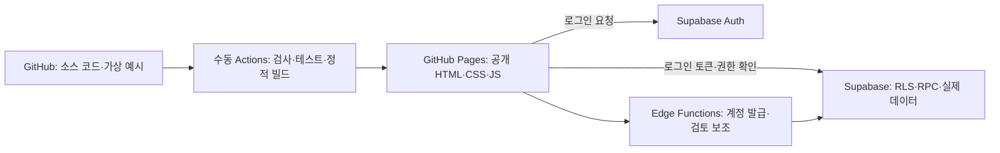

# 소통해용 임시 GitHub Pages 배포 설계

2026-11-08 사용자 승인으로 `leo-0229/sotonghaeyong_beta_1.0`을 공개하고 [Pages 임시 사이트](https://leo-0229.github.io/sotonghaeyong_beta_1.0/)를 배포했습니다. 현재 `locked-preview`이며 실제 Supabase 연결·회원 계정 발급은 아직 진행하지 않았습니다.

배포 검증: GitHub Actions 성공, 실제 HTTPS 접속·자산 로딩·해시 경로 새로고침·로그인 잠금·가상 역할 선택 및 학교 자료 미노출 확인. 공개 전 저장 이력 4개·파일 버전 77개에 비밀키/비공개 파일 패턴 검사를 수행했고, `npm audit --omit=dev` 결과 알려진 취약점은 0건이었습니다. 이 검사는 모든 개인정보나 미공개 취약점의 부재를 보장하지 않으며 실제 운영 서버의 권한 검증을 대체하지 않습니다.

## 공개되는 것과 보관 위치

| 항목 | 위치·공개 범위 |
| --- | --- |
| 소스·디자인·명확히 가상인 테스트 자료 | GitHub 저장소. 공개 저장소라면 누구나 읽을 수 있음 |
| 빌드 HTML·CSS·JavaScript | Pages에서 누구나 다운로드 가능. 화면 로그인으로 파일 자체를 숨길 수 없음 |
| Supabase URL·publishable/anon 키 | 공개 빌드 설정. 권한은 키 은닉이 아니라 서버의 Auth·RLS·RPC로 검증 |
| 이름·학번·성별·로그인 아이디·글·제출·교사명 검사 명단 | Supabase에만 저장. 소스·정적 빌드·Actions 변수·테스트 자료에 실제 값을 넣지 않음 |
| Auth 비밀번호 | Supabase Auth에서 관리. 최초 설정 전 임시 비밀번호를 서버에서 암호화 보관하고 L5만 재조회. 설정 완료 시 삭제 |
| service_role·AI 키 | Supabase 서버 비밀 설정. 최초 교사 발급용 service_role만 로컬의 무시된 `.env.admin.local`에서도 사용. GitHub에 등록하지 않음 |

GitHub Pages는 정적 파일을 공개하는 호스팅입니다. 비공개 저장소 사용 가능 여부는 요금제에 따라 다르며, 비공개 저장소를 썼다고 일반 Pages 사이트까지 비공개가 되는 것은 아닙니다. [GitHub 공식 안내](https://docs.github.com/en/pages/getting-started-with-github-pages/creating-a-github-pages-site)

브라우저용 publishable 키는 공개 전제이며, service_role·secret 키는 RLS를 우회하므로 브라우저에 넣지 않습니다. 빌드 설정 검증에서 잘못 넣은 secret/service_role 키를 거부합니다. [Supabase API 키 안내](https://supabase.com/docs/guides/getting-started/api-keys)

## 단계 1: 잠금 화면만 임시 배포

1. 저장소에는 이 프로젝트 소스만 올립니다. `out/`, `.env.local`, `.env.admin.local`, `.local/`, 실제 명단·백업·발급 결과는 올리지 않습니다.
2. 커밋 전 `npm.cmd run audit:release -- --source`를 실행합니다. Git 저장소가 생긴 뒤에는 **git add 후 다시 실행**해 추적 대상 파일을 검사합니다. 처음 만들 때는 공유 가능한 로컬 파일을 검사합니다.
3. Settings → Pages → Source에서 **GitHub Actions**를 선택합니다.
4. Actions → Deploy to GitHub Pages → Run workflow → **locked-preview**를 선택합니다.
5. 테스트·소스 검사·빌드·정적 결과 검사를 통과하면 `out/`만 업로드합니다. 저장소 이름이 `sotonghaeyong`이라면 `https://OWNER.github.io/sotonghaeyong/`에서 로그인 서버 미설정 안내를 표시합니다. 학교 콘텐츠와 가상 역할 선택은 제공하지 않습니다.

배포는 수동 실행만 허용합니다. `main`에 푸시한 것만으로 자동 배포되지 않습니다. 빌드 작업은 읽기 권한만, 배포 작업만 Pages 쓰기 권한을 갖습니다. 원하면 github-pages Environment에 GitHub의 승인 담당자를 설정할 수 있습니다.

## 단계 2: Supabase 연결과 5개 계정

새 임시 운영용 Supabase 프로젝트를 사용합니다. SQL `001 → 002 → 003 → 004 → 005 → 006 → 007 → 008_account_recovery_and_deletion.sql` 순서로 적용하고 `account-access`, `moderate-post`를 배포합니다. 공개 가입을 끄고 허용 Origin을 Pages 도메인으로 지정합니다. 자세한 연결 명령은 [배포 가이드](DEPLOYMENT.md)를 따릅니다.

| 레벨 | 임시 발급 수 | 역할 |
| --- | --- | --- |
| L1 | 제한 없음 | 일반 학생 |
| L2 | 제한 없음 | 반장 또는 부반장 중 한 명 |
| L3 | 제한 없음 | 학생회 임원 |
| L4 | 제한 없음 | 회장단 또는 홍보부장 중 한 명 |
| L5 | 제한 없음 | 담당 교사 |

007부터 등급별 인원 제한을 없앴습니다. 같은 학번과 같은 반·직책 중복은 금지하며, L5만 발급하고 최초 설정 전 임시 정보를 다시 확인할 수 있습니다. 임시 비밀번호 암호화 보관과 완료 후 삭제는 [계정 안내](ACCOUNTS.md)를 따릅니다.

먼저 운영자 CLI로 L5 한 명을 발급하고 첫 로그인 변경을 마칩니다. 이후 교사 화면에서 확인된 학번·이름·성별로 L1~L4 한 명씩 발급합니다. 임시 아이디·비밀번호는 소스·문서·Actions 로그·이슈에 남기지 말고 각 대상자에게 개별 전달합니다. CLI를 화면 녹화·터미널 기록·공유 로그가 켜진 곳에서 실행하지 않습니다. [계정 발급 안내](ACCOUNTS.md)

로컬 개발 화면의 가상 인물은 권한 시나리오를 검증하는 테스트 자료입니다. 운영 사이트에서는 실제 Supabase 인증을 사용하며, 공개 빌드의 가상 역할 선택은 차단합니다.

GitHub Actions Variables에는 `NEXT_PUBLIC_SUPABASE_URL`, `NEXT_PUBLIC_SUPABASE_PUBLISHABLE_KEY` 두 공개 값만 등록합니다. 다시 workflow를 **connected**로 실행하면 실제 로그인이 활성화됩니다.

## 글 공개 정책

모든 게시글은 `DRAFT → PENDING → 운영진 검토 → APPROVED/REJECTED` 순서입니다. 학생·임원·교사·공지 모두 같으며 자신의 글은 승인할 수 없습니다. 댓글도 승인 후 공개됩니다. 규칙·AI 결과는 검토 보조 정보이고 자동 공개 권한이 없습니다. AI 키는 이 정책을 위해 필수인 설정이 아닙니다.

브라우저와 Edge Function뿐 아니라 DB의 `store_moderated_post`도 `APPROVED`를 거부합니다. 승인 담당자(L3 이상)가 별도 `review_post`를 실행해야 공개됩니다. 기존 승인 글을 일괄 비공개로 바꾸지는 않으며 변경 후 신규 작성·재요청부터 이 정책을 따릅니다.

## 공개 직전 확인

- `npm.cmd test`, `npm.cmd run typecheck`, `npm.cmd run test:e2e`, `npm.cmd run build`, `npm.cmd run audit:release -- --out` 실행.
- GitHub로 올릴 파일 목록을 직접 확인. 실제 명단·글·비밀번호·교사 성함을 테스트 fixture나 seed로 복사하지 않음.
- 실제 연결 후 로그아웃·임시 비밀번호 미변경 상태의 REST/RPC 접근 거부와 타인의 미승인 글 비공개, 자기 승인 금지, 동일 등급 복수 발급과 최초 설정 후 임시 비밀번호 삭제를 확인.
- 무시 파일 규칙은 이미 커밋된 자료를 숨기지 않음. 키가 커밋되면 즉시 폐기·재발급하고 기록과 배포 결과도 정리.

패턴 검사는 흔한 비밀키와 비공개 파일을 차단하는 보조 수단입니다. 모든 개인정보를 자동 식별하거나 과거 Git 기록을 정리하지는 않습니다. 실제 Supabase·GitHub 통합 검증은 연결 후 수행해야 합니다.
